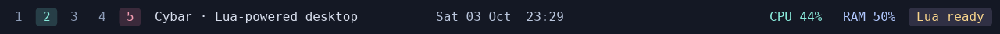
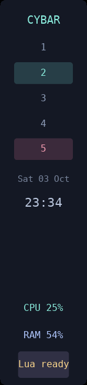

<p align="center">
  
</p>

# Cybar

A configurable status bar for Linux X11 desktops. Keep workspaces, the current
window, system readings, and tray icons in view, then make the bar your own with
Lua.



*The [horizontal example](examples/horizontal.lua), captured from Cybar running
on Xvfb. Workspace names and window titles are demonstration data.*

## Make it yours

- Place a bar on any screen edge, with the size, spacing, and colors you prefer.
- Show workspaces, window titles, a clock, CPU and RAM readings, and tray icons.
- Arrange modules in left, middle, right, or custom sections.
- Add image or theme icons, choose fonts, and style hover, active, and warning states.
- Configure each monitor independently, including display scaling.
- Add custom statuses with Lua functions, commands, or live streams.
- Assign clicks, scrolling, and messages to your own actions.

Cybar works with EWMH-compatible window managers and accepts Lua adapters for
other WM protocols. It requires an X11 session and installed desktop fonts.
LuaJIT is the default runtime; a Lua 5.4 variant offers the same configuration API.

<p>
  
</p>

*The [vertical example](examples/vertical.lua), captured from a running Cybar on
Xvfb, shows a floating bar on the left edge.*

## Get started

[BUILD.md](BUILD.md) contains installation and package instructions. This checkout
includes Debian and Arch packaging; published downloads are not configured.

Copy the example configuration, check it, and start Cybar from your X11 session:

```sh
mkdir -p "${XDG_CONFIG_HOME:-$HOME/.config}/cybar"
cp examples/config.lua "${XDG_CONFIG_HOME:-$HOME/.config}/cybar/config.lua"
cybar check
cybar
```

Installed packages put the example at `/usr/share/doc/cybar/config.lua`. The
configuration lives at `$XDG_CONFIG_HOME/cybar/config.lua`, or
`~/.config/cybar/config.lua` by default. Use `cybar --config /path/to/config.lua`
to choose another file. Add `cybar` to your window manager's startup commands
when you want it to start with your desktop.

## A little Lua, your layout

```lua
local bar = require("cybar")

return {
  bars = {{
    name = "main", monitor = "primary", position = "top",
    size = { thickness = 28, length = "100%" },
    sections = {
      left = { bar.workspaces{}, bar.window_title{ max_length = 32 } },
      middle = { bar.clock{ format = "%a %d %b  %H:%M" } },
      right = { bar.cpu{}, bar.ram{}, bar.systray{} },
    },
  }},
}
```

Use logical pixels or percentages for dimensions, choose `top`, `bottom`, `left`,
or `right`, and set `reserve_space = false` for a floating bar. The
[configuration reference](docs/configuration.md) covers fonts, icons, state
colors, sections, and monitor overrides. See [examples/custom.lua](examples/custom.lua)
for custom statuses and interactions.

Edits to your configuration and its required Lua files reload automatically.
If a reload contains an error, Cybar keeps the current bar and prints the error
in the terminal.

## Control your bar

```sh
cybar reload        # Reload the configuration now.
cybar toggle main   # Hide or show the named bar.
cybar quit          # Shut down cleanly.
```

Custom modules can receive text with `cybar msg` and answer `cybar request`.
Use `name@monitor` to target a module on a particular display. The
[Lua API](docs/lua-api.md) explains actions, module handles, timers, and sources;
[WM backends](docs/wm-backends.md) explains adapters. Run `cybar --help` or
`man cybar` for command help, and see [current limitations](docs/implementation-status.md)
for compatibility notes.

## License

<a href="LICENSE"></a>

Cybar is free software licensed under [GPL-3.0-or-later](LICENSE).
